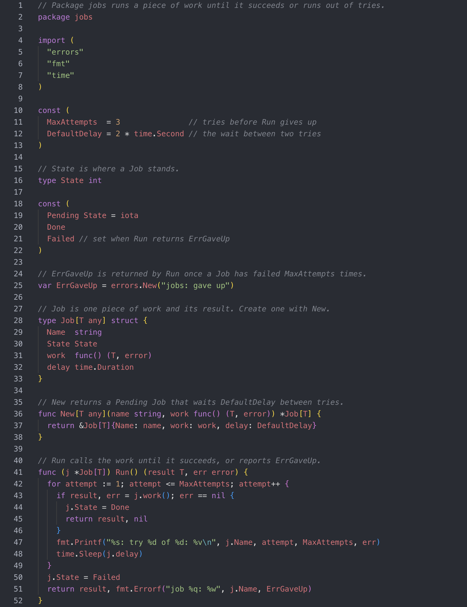
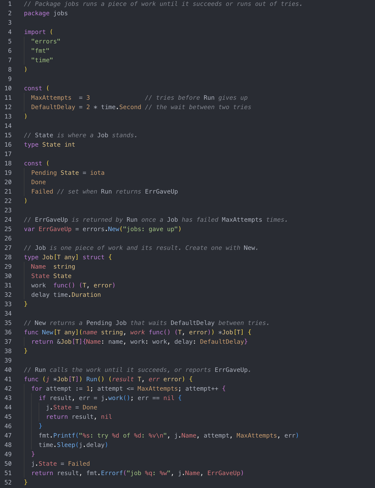

# Go Syntax for Orca

Rich syntax highlighting for Go in [Orca](https://github.com/stablyai/orca) 1.4.246 or newer, plus
`go.mod` and `go.work`.

Orca highlights Go out of the box, but with a tokenizer that only knows keywords, strings, comments
and numbers: every identifier is one colour. This plugin replaces it with a grammar that tells
names apart by what they are, in the way GoLand does.

| Orca's built-in Go highlighting | With Go Syntax |
| --- | --- |
|  |  |

The same file, [`examples/sample.go`](examples/sample.go), in the same theme.

**Highlighting only.** No completion, navigation or diagnostics. The plugin is data: it runs no
code and asks for no access.

## What gets its own colour

| In the code | Orca token type | One Dark Pro |
| --- | --- | --- |
| Type names, builtin types (`Store`, `*sql.DB`, `string`, `error`), type parameters | `type` | yellow |
| Function and method declarations and calls, builtins (`len`, `make`) | `function` | blue |
| Parameters, receivers and named results, where they are declared | `variable.parameter` | italic |
| Exported struct fields, `x.Field`, exported variables where declared or assigned, `Err…` names, `nil` | `identifier` | red |
| Constants where declared, other exported names in expressions (`SchemaVersion`), `true`, `false`, `iota` | `constant` | orange |
| Format verbs (`%s`, `%w`) and escapes (`\n`) inside strings | `regexp` | red |
| Keywords, with control flow (`if`, `return`, `go`, `defer`) as `keyword.flow` | `keyword` | purple |
| Locals, unexported fields, package names (`fmt`, `sql`), labels | none | default text |
| Names from the code inside a comment | none | default text, against grey prose |

Colours come from your Orca theme; the last column is what the bundled One Dark Pro shows.

In `go.mod` and `go.work`: directives are keywords, module paths and directories are strings,
versions are numbers.

## What a grammar cannot know

A TextMate grammar reads syntax, one line at a time, with no knowledge of what a name refers to.
So, unlike GoLand:

- A parameter is coloured in the signature, not where the body uses it.
- An exported name in an expression is taken for a constant, and one after a dot for a field. So
  an exported variable other than an `Err…` one (`DefaultClient`) looks like a constant, and a
  constant from another package (`pkg.MaxSize`) looks like a field. Common standard library
  constants such as `time.Second` and `http.StatusOK` are listed and come out right.
- A name in a comment is recognised by its shape, not looked up: the word a doc comment opens
  with (`// Open opens…`), `mixedCaps`, `pkg.Name`, `name()`, `[Name]`, and a capitalised word in
  the middle of a sentence. A lower-case name mid-sentence is missed, and a proper noun mid-sentence
  is picked up.
- A conversion such as `ID(x)` looks like a call, so `ID` is coloured as a function.
- A capitalised local would be coloured as exported. Go style keeps locals lower case.
- Reassigned variables, unused names and doc-comment links are not marked.

Orca also leaves a file plain past 500,000 characters or 20,000 lines, and stops colouring at a
line longer than 1,000 characters.

## Install

```sh
orca plugin install saltshakerlabs/orca-go-syntax
```

## Develop

```sh
npm install                  # the TextMate engine the tests tokenize with
npm test                     # tokenizes Go and go.mod and checks the token types
npm run tokens -- examples/sample.go            # print how Orca would colour a file
npm run tokens -- examples/sample.go --scopes --lines 48-54
orca plugin validate .
orca plugin dev load .       # load this folder into the running Orca; edits reload on save
```

Then open `examples/sample.go` and `examples/gomod/go.mod` in Orca. `orca plugin dev unload .`
removes it again.

Use `npm test`, not `orca plugin test`: the tests need the real TextMate engine from npm, and
Orca's runner only loads what a plugin itself may import.

### How the Go grammar is built

`syntaxes/go.tmLanguage.json` is generated. Do not edit it.

```sh
node tools/build-grammar.mjs
```

The script takes the grammar in `third_party/go-syntax` (the one VS Code ships) and changes which
scope each token gets. Orca reduces every TextMate scope to one of 24 token types and themes colour
only those, so upstream's scopes, written for VS Code themes, put builtin types among the keywords
and paint every variable alike. The header of `tools/build-grammar.mjs` lists the mapping.

To take a newer upstream grammar, replace `third_party/go-syntax/go.tmLanguage.json`, rebuild, and
run the tests.

`tools/orca-tokens.mjs` carries a copy of Orca's scope-to-type table (from Orca 1.4.277). If Orca
changes that table, the tests keep passing but stop describing what Orca draws; update the copy.

| File | Purpose |
| --- | --- |
| `orca-plugin.json` | Manifest |
| `syntaxes/go.tmLanguage.json` | Go grammar, generated |
| `syntaxes/gomod.tmLanguage.json` | `go.mod` and `go.work` grammar, written by hand |
| `syntaxes/*.language-configuration.json` | Comment markers, brackets, auto-closing pairs |
| `third_party/go-syntax/` | Upstream Go grammar and its licence |
| `tools/` | Grammar build script, tokenizer and token printer |
| `examples/` | A short Go file and a `go.mod` to open in Orca |
| `images/` | The screenshots above |
| `tests/` | Tokenizer tests, and the longer Go fixture they time |

## Licence

MIT; see [LICENSE](LICENSE). The Go grammar derives from
[worlpaker/go-syntax](https://github.com/worlpaker/go-syntax), MIT, © 2023 Furkan Ozalp; see
[third_party/go-syntax/LICENSE](third_party/go-syntax/LICENSE).
